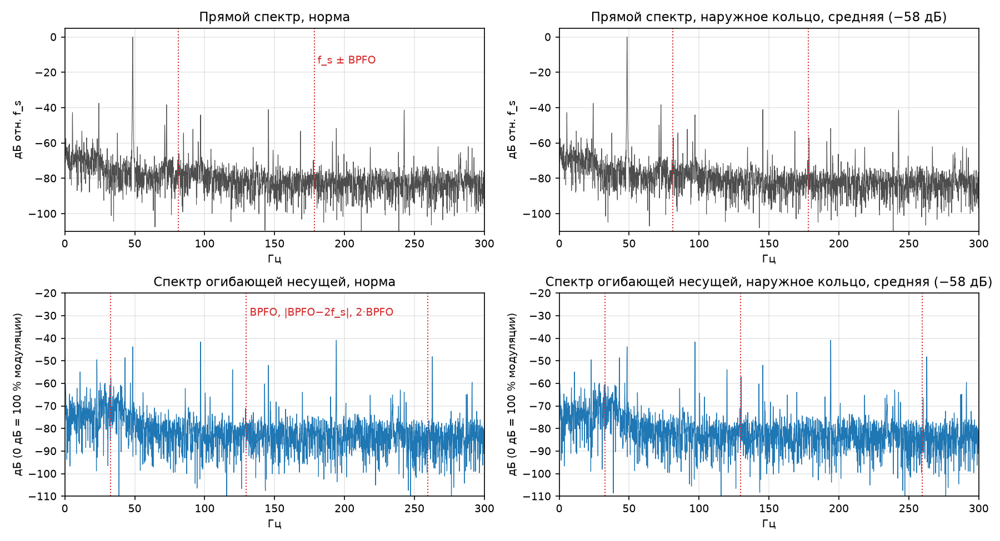
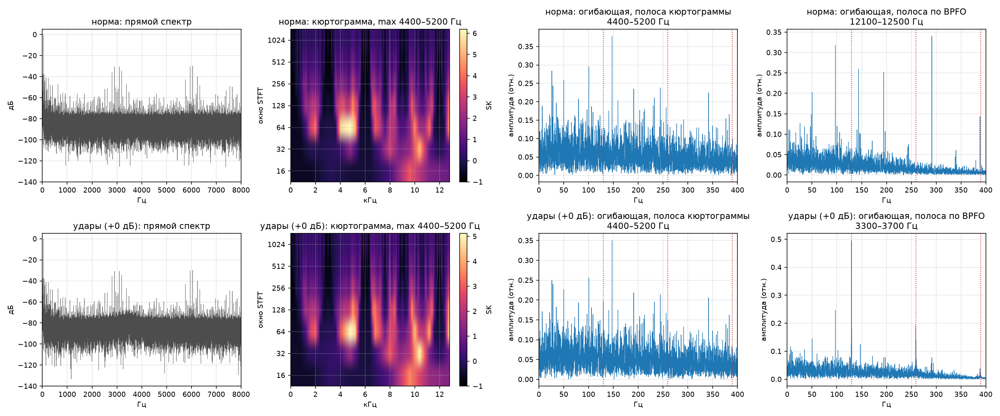
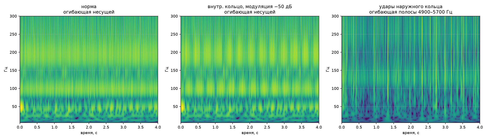
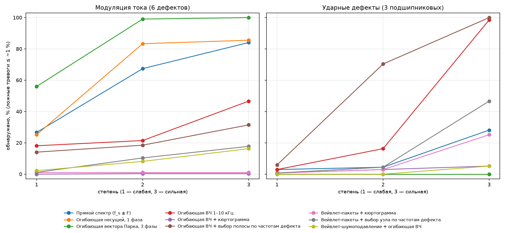

# Три метода поиска дефектов по току: плюсы и минусы

> Проект: [AltAiManfMash](https://github.com/hitmanmaaan/AltAiManfMash). Все цифры — из `analysis/compare_methods.csv`
> (синтетические дефекты, внедрённые в 45 реальных записей; доля обнаруженных при уровне ложных тревог ≲ 1 % на настройке).

## Коротко

| | Прямой спектр | Спектр огибающей | Вейвлет |
|---|---|---|---|
| **Идея** | ищем пики f_s ± F рядом с частотой питания | берём «контур громкости» тока и ищем дефект прямо на F | раскладываем сигнал на «время × частота» |
| **Обычные дефекты** (модуляция: дисбаланс, кольца, сепаратор) | ✅ средние и сильные | ✅✅ лучший (вектор Парка), ловит даже слабые | ❌ почти не ловит |
| **Удары / царапины** | ❌ почти не видит | ✅ только ВЧ-огибающая с выбором полосы | ⚠️ только сильные |
| **Слабые дефекты** | ❌ | ⚠️ модуляция — да, удары — нет | ❌ |
| **Ложные тревоги** | 13 % | 6 % (Парк) / 11 % (ВЧ) | 0–7 % |
| **Нагрузка на железо** | низкая (512 отсч/с) | низкая (Парк) / высокая (ВЧ, 25,6 кГц) | высокая |
| **Итог** | база, дёшево | **основной метод** | для картинок и проверки стационарности |

**Вывод:** один метод не покрывает всё. Рабочая связка — **огибающая вектора Парка** (обычные дефекты)
\+ **ВЧ-огибающая с выбором полосы** (удары, т. е. царапины). Прямой спектр — как дешёвая первичная проверка.

---

## Два типа симптомов (почему методы ведут себя по-разному)

1. **Модуляция.** Дефект слегка качает нагрузку с частотой F → амплитуда тока «дышит» →
   в спектре рядом с f_s ≈ 48,5 Гц появляются боковые полосы **f_s ± F**.
2. **Удары.** Царапина/скол: каждый шарик, проезжая по ней, бьёт → короткий «звон» на 2–6 кГц,
   повторяется с частотой дефекта (BPFO — наружное кольцо, BPFI — внутреннее). Интервалы чуть плавают
   (шарики проскальзывают), поэтому стабильной линии в обычном спектре нет.

---

## 1. Прямой спектр (MCSA)

**Как работает:** спектр тока (FFT) → ищем пики на f_s ± F → сила пика в дБ над местным шумом.

**Плюсы**
- Самый простой и быстрый, стандарт отрасли.
- Хватает полосы 0–150 Гц → сигнал прореживается до 512 отсч/с, очень дёшево для чипа.
- Средние и сильные модуляционные дефекты: **96–100 %** (кроме тел качения средней силы — 7 %).
- Наглядно: «вот пик, вот частота дефекта».

**Минусы**
- **Удары (царапины) почти не видит:** 0–18 %, лишь сильное наружное кольцо — 67 %.
- Расцентровку не ловит даже сильную (4 %): 2×f_r совпадает с линиями самого стенда.
- Слабые дефекты: 0–49 % (кроме дисбаланса — 84 %).
- Ложные тревоги **13 %**.
- Нужна очень точная скорость вала: ошибка 0,3 % уводит пик из окна поиска.

---

## 2. Спектр огибающей

**Как работает:** огибающая = контур амплитуды сигнала (преобразование Гильберта) → её спектр.
Дефект оказывается **прямо на частоте F**, а не парой вокруг f_s.

| Вариант | Что делает | Для чего |
|---|---|---|
| Огибающая несущей, 1 фаза | огибающая тока одной фазы | модуляция |
| **Огибающая вектора Парка** | 3 фазы → один сигнал (модуль вектора) | модуляция, лучший |
| ВЧ-огибающая 1–10 кГц | фильтр → огибающая | удары |
| ВЧ + кюртограмма | полоса выбирается по «импульсности» | удары (в теории) |
| **ВЧ + выбор полосы по частотам дефекта** | полоса, где лучше всего видна частота дефекта | удары, лучший |

**Плюсы**
- **Вектор Парка — лучший для модуляции:** средние и сильные — 97–100 %; слабые: внутреннее кольцо и
  дисбаланс 100 %, наружное 61 %, сепаратор 58 %. Единственный ловит расцентровку (97 % при средней).
  Ложных тревог всего 6 %.
- **ВЧ-огибающая с выбором полосы — единственный рабочий метод для ударов (царапин):**
  сильные — 100 %, средние — 47–84 %.
- Ответ сразу на частоте дефекта, без «зеркальных» пар.

**Минусы**
- Варианты для модуляции к ударам слепы (0 %), ВЧ-варианты почти не ловят модуляцию → нужны оба.
- **Слабые удары не ловит никто** (2–9 %).
- **Кюртограмма проваливается** (0–11 %): самое «импульсное» в токе — импульсы ШИМ преобразователя
  на 4–5 кГц, и кюртограмма выбирает их вместо дефекта.
- Ложные тревоги ВЧ: 11–18 %.
- Парку нужны все 3 фазы (в части записей одной фазы нет); ВЧ нужна полная частота 25,6 кГц.

---

## 3. Вейвлет-анализ

**Как работает:** сигнал сканируется короткой «волночкой» разного масштаба → картинка время × частота
(скалограмма). Спектр — «какие ноты в аккорде», вейвлет — «партитура: какая нота когда».

Варианты в проекте: CWT-скалограмма (Морле), вейвлет-пакеты (db8, 64 полосы по 200 Гц) + кюртограмма
или выбор полосы по частоте дефекта, вейвлет-шумоподавление (порог Донохо).

**Плюсы**
- Видна нестационарность: скачки нагрузки, появление/исчезновение дефекта, одиночные удары.
- Лучшие картинки для отчёта и защиты.
- Вейвлет-пакеты с выбором полосы: сильные удары по наружному кольцу — 91 %.
- Шумоподавление не даёт ложных тревог (0 %).

**Минусы**
- На этих данных **хуже огибающей почти везде:** средние удары 0–11 %, слабые 0 %, модуляция ~0 %.
- Записи стационарны (показала скалограмма) → главное преимущество вейвлета здесь не нужно.
- Та же ловушка с ШИМ, что у кюртограммы.
- Много параметров (вейвлет, уровни, пороги) — сложно настраивать.
- Тяжело считать и переносить на чип.

---

## Сводка по цифрам

Доля обнаруженных дефектов, **слабый / средний / сильный**:

| | Прямой спектр | Огибающая Парка | ВЧ-огибающая (выбор полосы) | Вейвлет-пакеты (выбор полосы) |
|---|---|---|---|---|
| Кольца, сепаратор (модуляция) | 0–49 / 96–100 / 100 % | **58–100 / 100 / 100 %** | 0–4 / 0–2 / 4–60 % | ~0 % |
| Дисбаланс | 84 / 100 / 100 % | **100 / 100 / 100 %** | 71 / 100 / 100 % | 0 / 56 / 100 % |
| Расцентровка | 2 / 2 / 4 % | **17 / 97 / 100 %** | ~4 % | ~2 % |
| **Удары (царапины)** | 0–9 / 0–13 / 0–67 % | 0 % | **2–9 / 47–84 / 100 %** | 0–2 / 0–11 / 0–91 % |
| Ложные тревоги | 13 % | **6 %** | 11 % | 7 % |

> ⚠️ Все цифры — на **синтетике** (дефекты внедрены программно). На настоящих царапинах не проверено.
